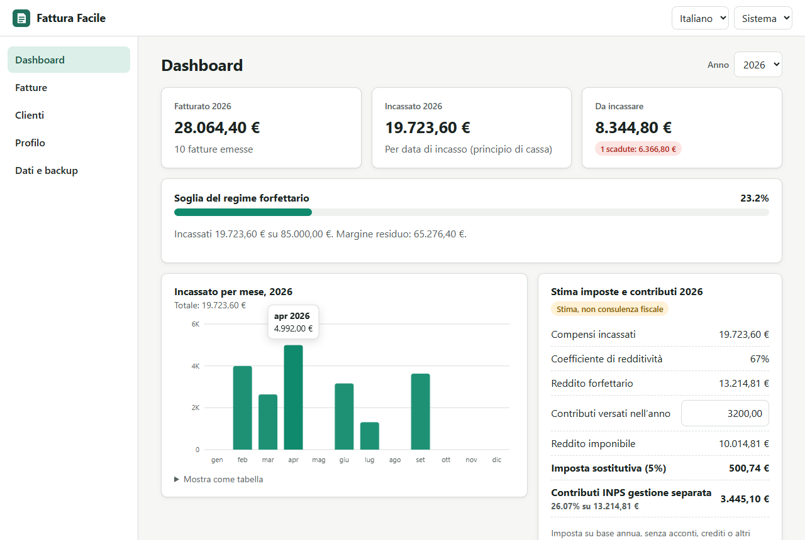
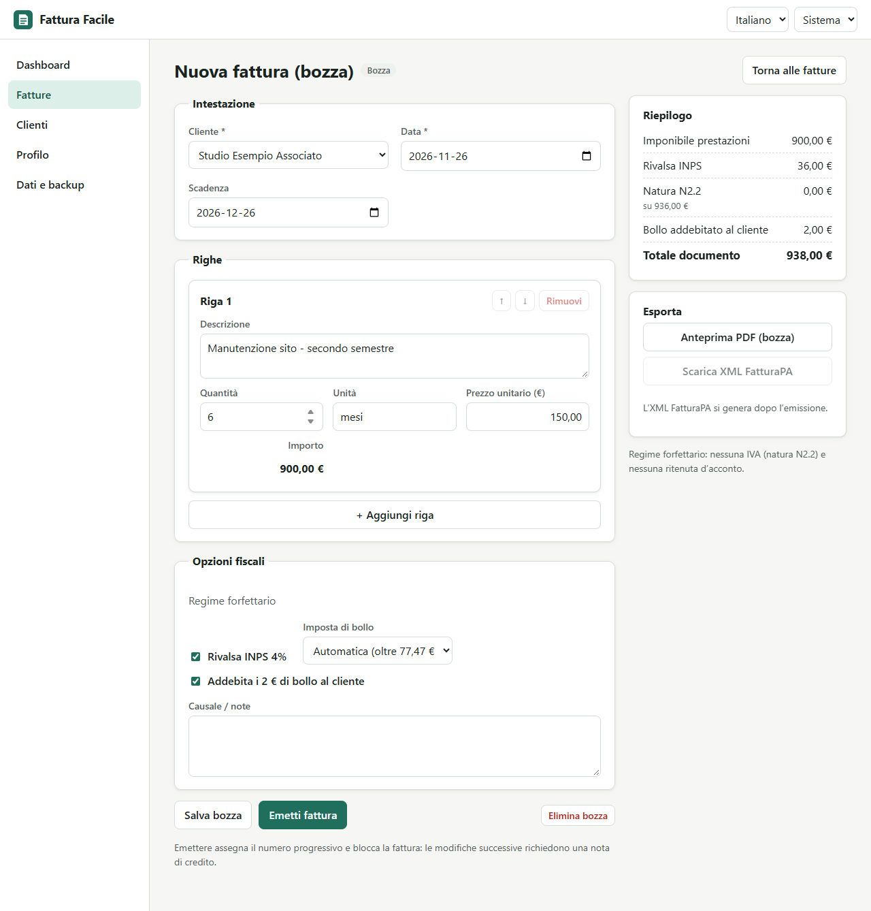
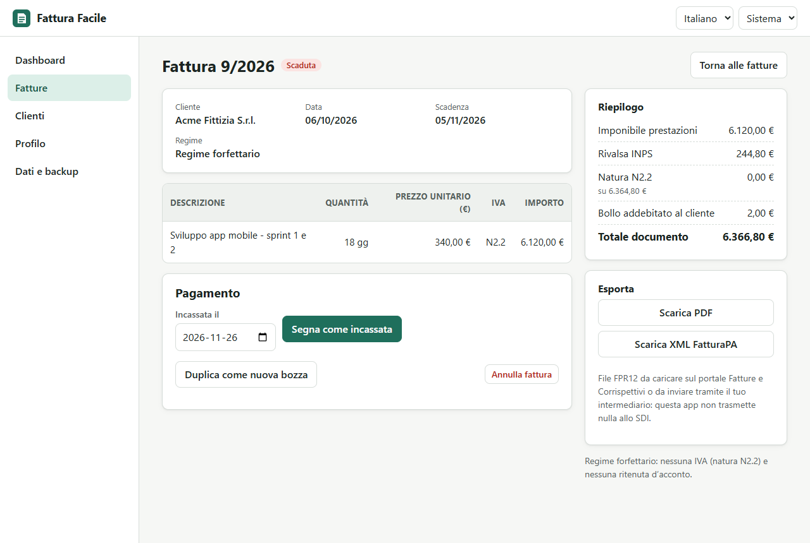
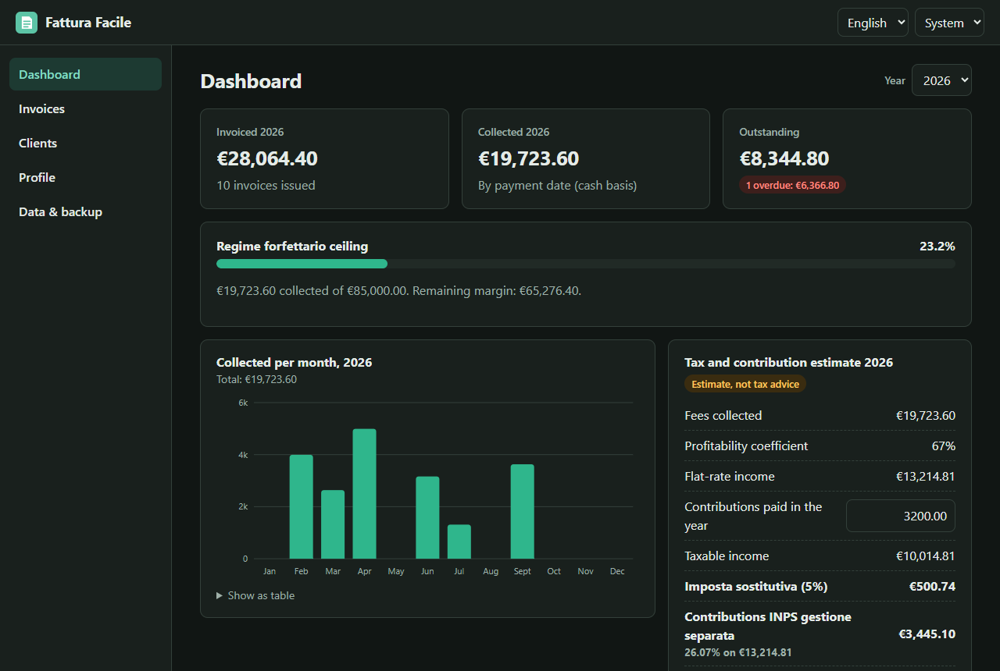
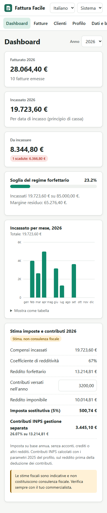

# Fattura Facile

[](https://github.com/Shgabnaz1377/fattura-facile/actions/workflows/ci.yml)


**Invoicing and tax estimates for Italian freelancers (partita IVA), local-first.**
Create clients and invoices, export a clean PDF and a **FatturaPA XML (FPR12) validated against the official schema**, track payments, and see how close you are to the regime forfettario ceiling with an estimate of imposta sostitutiva and INPS contributions. Everything is stored in your browser and there is no server.

> **Disclaimer.** This is a personal portfolio project, not tax software certified for anything. The tax figures are **estimates, not tax advice**. Rules and yearly amounts change; verify everything with your *commercialista* before relying on it. The app never transmits anything to SDI (Sistema di Interscambio).



| Invoice editor (draft) | Issued invoice |
|---|---|
|  |  |

| Dark mode, English | Phone |
|---|---|
|  |  |

The screenshots come from the production build with the built-in demo dataset. `npm run screenshots` drives the app with Playwright and recreates them.

## Features

- **Business profile**: partita IVA and codice fiscale (validated), address, IBAN, regime **forfettario** or **ordinario**, coefficiente di redditività by ATECO group (with a suggestion from your ATECO code, or a custom value), 5% start-up rate, pension scheme (INPS gestione separata, artigiani, commercianti, or a cassa professionale), invoice defaults.
- **Clients**: companies, private individuals and foreign clients. The **partita IVA and codice fiscale check digits** are computed with the official algorithms, omocodia included. You also set the SDI recipient code or PEC.
- **Invoices**: line items with quantity, unit and price; **IVA 22/10/5/4/0%** with **natura N1–N7** (including the 2021 sub-codes N2.1…N6.9); **rivalsa INPS 4%**; **ritenuta d'acconto**; **marca da bollo €2** above €77.47 (automatic, forced on, or forced off; charged to the client or not); live totals; **sequential numbering per year** assigned when you issue, with duplicate and chronology checks; payment status (unpaid, overdue, paid on a date, cancelled); duplicate as new draft.
- **PDF export** (pdf-lib): A4 layout with the issuer, recipient, line table, totals, legal notes and payment details. Long invoices get multiple pages.
- **FatturaPA XML export** (FPR12, TD01): checked in CI against the official **Schema_VFPR12 v1.2.4** XSD.
- **Dashboard**: invoiced vs collected (cash basis), outstanding and overdue, **€85,000 forfettario ceiling** progress, monthly collections chart, and the **imposta sostitutiva + INPS estimate**.
- **Data**: JSON backup export/import, a **demo dataset** button, delete everything.
- **Italian and English UI** (Italian by default), **light/dark/system theme**, responsive down to phone width, keyboard and screen-reader friendly (labelled fields, `aria-invalid` messages, focusable chart columns with a table view, skip link).

## Tax rules implemented

These are the rules I am confident are correct as of 2026. Each one is referenced in [`src/domain/tax/rules.ts`](src/domain/tax/rules.ts).

| Rule | Value in the app | Source |
|---|---|---|
| Forfettario revenue ceiling | €85,000 of fees **collected** in the year | L. 190/2014 c. 54, as amended by L. 197/2022 |
| Immediate exit | above €100,000 the regime ends in the same year | L. 190/2014 c. 71 |
| Taxable income | collected fees × coefficiente − social contributions paid in the year (never below 0) | L. 190/2014 c. 64 |
| Imposta sostitutiva | 15%, or 5% for the year the activity started and the following four, **if you declare you meet the conditions** | L. 190/2014 c. 64–65 |
| Coefficienti di redditività | 40% (food, retail, street food, hospitality), 54% (other street trade), 62% (commercial agents), 78% (professional, scientific, technical, health, education, finance), 86% (construction, real estate), 67% (other) | Allegato 4, L. 190/2014 |
| Forfettario invoices | no IVA, natura **N2.2**, RegimeFiscale **RF19**, legal notes printed, no ritenuta | L. 190/2014 c. 54–89 and c. 67 |
| Marca da bollo | €2 when the amount without IVA is **above €77.47**; applied automatically for N2.2 and N4 lines, paid virtually | DPR 642/1972, DM 17/06/2014 |
| Rivalsa INPS | up to 4% for gestione separata, follows the IVA treatment of the fees, subject to ritenuta; exported as `DatiCassaPrevidenziale` TC22 | L. 662/1996 art. 1 c. 212 |
| Ritenuta d'acconto | 20% default (editable), on fees + rivalsa, RT01/RT02, causale A, regime ordinario only | DPR 600/1973 art. 25 |
| IVA | computed once per rate/natura group and rounded to the cent, as FatturaPA `DatiRiepilogo` expects | FatturaPA specifications |

### Configurable, because I am not sure of the 2026 values

- **INPS parameters** (gestione separata rate and income cap, artigiani/commercianti minimum income, fixed amounts, rates, cap, 35% reduction) change every year with INPS circulars. The defaults are the **2025 figures**: 26.07%, cap €120,607, minimum income €18,555, fixed contributions €4,460.64 (artigiani) and €4,549.70 (commercianti), rates 24% and 24.48%. They are editable in *Profilo → Parametri INPS*, and the dashboard shows which year they come from. Update them when the 2026 circulars are out.
- **Ritenuta rate** (default 20%) and **rivalsa rate** (4%) are per invoice.
- **Stamp duty** outside N2.2/N4 (some N3 non-taxable operations, operations outside the scope of IVA) depends on the specific operation, so the editor lets you force it on or off instead of guessing.
- **ATECO → coefficient** mapping follows the ATECO 2007 ranges in the law. ATECO 2025 moved some codes, so you can always choose the group by description or enter a custom coefficient.

### Not covered

IRPEF estimates for the regime ordinario, acconti and the tax calendar, credit notes (TD04), PA invoices (FPA12), split payment, deferred VAT (esigibilità differita), foreign private individuals without a VAT number in the XML, the rules of professional pension funds (casse), and digital signature or transmission to SDI.

## FatturaPA XML

The generator ([`src/domain/fatturapa/fatturapa.ts`](src/domain/fatturapa/fatturapa.ts)) builds the FPR12 structure in schema order: transmission data (recipient code, `0000000` + PEC, or `XXXXXXX` for clients abroad), cedente and cessionario, ritenuta, virtual bollo, rivalsa as cassa TC22, lines, IVA summary with natura and legal reference, and bank transfer payment data. Text is limited to Latin-1 and to the field lengths, and the file is named `IT<codice fiscale>_<progressivo>.xml`.

It is validated in two ways:

1. **Structural and amount checks** (`fatturapa.test.ts`): element order and values, plus the SDI consistency rules (line totals + cassa contributions = taxable amount per group, IVA = taxable × rate, document total, amount to pay = total − ritenuta).
2. **The official XSD** (`fatturapa.xsd.test.ts`): `npm run xsd:fetch` downloads Schema_VFPR12 v1.2.4 from [fatturapa.gov.it](https://www.fatturapa.gov.it/) and the W3C xmldsig schema it imports into `.cache/`. They are fetched from the publishers and not copied into this repository. [xmllint-wasm](https://github.com/noppa/xmllint-wasm) (libxml2) then validates five invoice variants and one deliberately broken document. CI always fetches the schema and fails if the validation cannot run.

## Architecture

```
src/
  domain/            pure TypeScript, no Vue: everything with rules lives here
    validators/      partita IVA, codice fiscale (omocodia), IBAN, SDI code, CAP…
    tax/             rules + sources, coefficients, invoice totals, forfettario/INPS estimate
    fatturapa/       FPR12 XML builder and minimal XML serializer
    money.ts         integer cents, exact half-up rounding
    numbering.ts     yearly progressive numbers, chronology and gap checks
    invoices.ts      draft → issued (snapshot of issuer and client) → paid/cancelled
    document.ts      renderer-independent model of the printed invoice
    dashboard.ts     invoiced vs collected, outstanding, monthly series
    demo.ts          fictitious demo dataset
  pdf/               pdf-lib renderer for the document model (lazy-loaded)
  db/                Dexie (IndexedDB) schema, JSON backup/restore
  stores/            Pinia stores: profile, clients, invoices
  views/, components/ Vue 3 single-file components
  i18n/              Italian (default) and English messages
scripts/             XSD download, README screenshots
```

Design choices:

- **Money is integer cents.** Rates are applied in basis points with integer division, so `0.1 + 0.2` and `1.005` never drift.
- **The domain layer has no UI imports.** The PDF renderer and the XML builder both consume the same totals, so the invoice page, the PDF and the XML cannot disagree.
- **Issuing freezes the data.** Numbers are assigned inside an IndexedDB transaction, and the profile and client are copied into the invoice. Issued invoices are never deleted, only cancelled (the number stays used).
- **Local-first.** The data lives in IndexedDB, there is no backend and no tracking, and the app is a static build with hash routing, so it works from any static host.

## Local development

Requires Node.js 22 or newer.

```bash
npm install
npm run dev            # http://localhost:5173
npm test               # Vitest (the XSD test is skipped until the schema is fetched)
npm run xsd:fetch      # download the official FatturaPA schema into .cache/
npm run lint
npm run typecheck
npm run build          # type-check + production build into dist/
npm run preview        # serve the build on http://localhost:4173
npm run screenshots    # with the preview running: regenerate docs/screenshots
```

`npm run screenshots` needs a Playwright browser: run `npx playwright install chromium` once, or set `PW_CHANNEL=chrome` to use an installed Chrome.

Click **Carica dati demo / Load demo data** on the empty dashboard to try the app with a fictitious freelancer, four invented clients and ten invoices. Every Italian partita IVA and codice fiscale in the demo and in the tests is check-digit valid but made up.

### Tests

185 Vitest tests (as of this README) cover: validators against known valid and invalid identifiers, including an exhaustive single-digit mutation check; money rounding; invoice totals in both regimes (bollo threshold at 77.47 vs 77.48, rivalsa and ritenuta math); the forfettario and INPS estimates; numbering; client and profile rules; stores and backup on `fake-indexeddb`; the PDF (parsed back with pdf-lib); the FatturaPA structure, amounts and XSD; and i18n key and placeholder parity. CI runs lint, type-check, the tests with the XSD and a production build on every pull request.

## Riepilogo in italiano

**Fattura Facile** è un'app web per partite IVA che funziona interamente nel browser: i dati restano sul tuo dispositivo (IndexedDB) e non c'è nessun server.

- Anagrafica attività con regime **forfettario** od **ordinario**, coefficiente di redditività per gruppo ATECO, aliquota agevolata del 5%, gestione separata INPS o artigiani/commercianti.
- Clienti con **controllo reale di partita IVA e codice fiscale** (carattere di controllo, omocodia).
- Fatture con IVA 22/10/5/4/0 e **nature N1–N7**, **rivalsa INPS 4%**, **ritenuta d'acconto**, **marca da bollo da 2 €** oltre 77,47 €, **numerazione progressiva annuale**, stato dei pagamenti.
- Esportazione **PDF** e **XML FatturaPA FPR12**, validato contro lo **schema XSD ufficiale** dell'Agenzia delle Entrate. L'app non invia nulla allo SDI.
- Dashboard con fatturato, incassato (principio di cassa), **soglia degli 85.000 €** e **stima** di imposta sostitutiva e contributi INPS.
- Backup JSON, dati demo, interfaccia in italiano e inglese, tema chiaro/scuro.

**Attenzione:** le stime sono indicative e **non costituiscono consulenza fiscale**. I parametri INPS cambiano ogni anno: quelli predefiniti sono i valori 2025 e vanno aggiornati nel profilo. Verifica sempre con il tuo commercialista.

## License

[MIT](LICENSE) © 2026 Shabnaz Ghaffari
